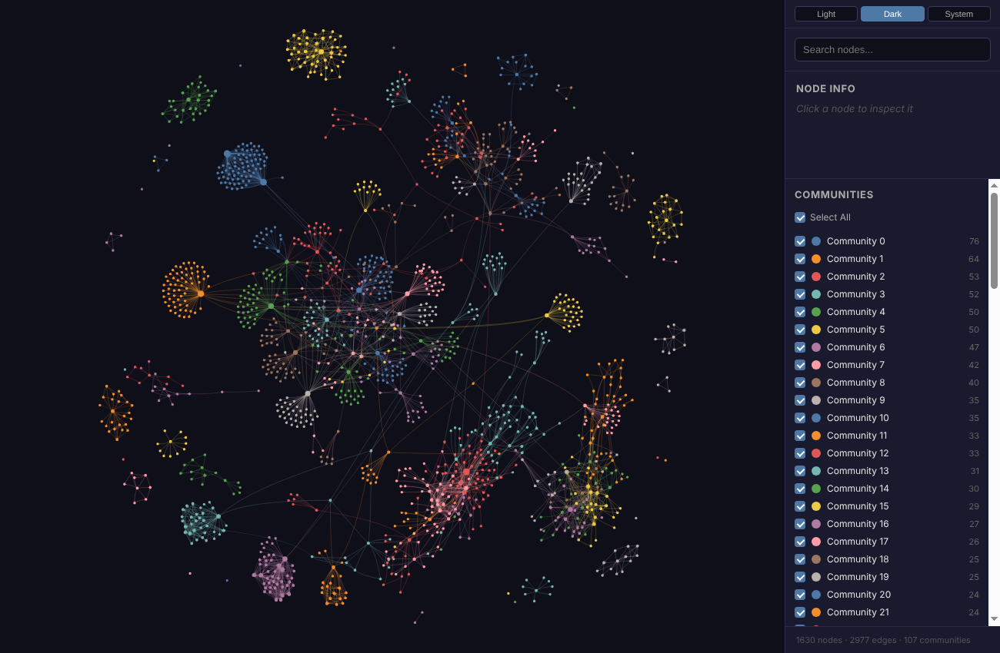

# பண்ணைப்புரம் — Pannaipuram
### உங்கள் ஊரின் தகவல் மையம் — Your village's information centre

A Tamil-first village information app for **Pannaipuram, Theni District, Tamil Nadu**: bus timings, auto/van drivers, doctors, emergency numbers, local services and a village news feed — in one place, working offline.

**Open it (share this on WhatsApp):** https://app.pannaipuram.com — on a phone, `https://app.pannaipuram.com/?install=1` offers a one-tap "add to home screen".

## What's in it

| Tab | Tamil | What it does |
|---|---|---|
| 🚌 Bus | பேருந்து | Timetables for every route through the Pannaipuram stop, a live "leaving soon" strip, next-bus countdowns, search |
| 🛺 Auto | ஆட்டோ | Auto / van / car drivers grouped by vehicle, one-tap call, driver registration |
| 📰 Community | சங்கமம் | Village news feed — read and like freely, post after a one-time phone registration (admin-moderated) |
| 🏥 Medical | மருத்துவம் | Doctors by hospital, weekly timings, "available today" badge, call chips |
| ➕ More | மேலும் | Substitute (acting) drivers and local services (milk, electrician, …) |
| 📞 Emergency | அவசரம் | 108 / 100 / 101 quick-dial and grouped helplines (opened from the ☰ menu) |

Plus announcements from the admin, light/dark mode, and works offline after the first load.

## How it's built

| Part | Tech | Folder |
|---|---|---|
| Web app (PWA) | Vanilla JS + CSS, no build step | [`pwa/`](pwa/) |
| API | Node.js + Express | [`backend/`](backend/) |
| Admin panel | React + MUI (Vite) | [`admin-ui/`](admin-ui/) |
| Database | PostgreSQL on Supabase | cloud |
| Android app | Flutter (older; the PWA is the main product) | [`app/`](app/) |

Hosting: the PWA on GitHub Pages (`app.pannaipuram.com`), the API and admin on Render (`api.` / `admin.pannaipuram.com`), DNS on Cloudflare.

### Code map (graphify)



**Open it interactive:** [anyone, via htmlpreview](https://htmlpreview.github.io/?https://github.com/VenthanGowthamS/Pannaipuram/blob/main/graphify-out/graph.html) · [Venthan's hosted copy](https://claude.ai/artifact/WLjNoauJX4QDEP3jCz3c9n)

Made with [graphify](https://github.com/Graphify-Labs/graphify): every function, component and SQL table in the app, backend, admin panel and PWA, joined by the calls and imports between them. Open [`graphify-out/graph.html`](graphify-out/graph.html) locally to click through it; [`GRAPH_REPORT.md`](graphify-out/GRAPH_REPORT.md) lists the most connected parts. Refresh after code changes with `graphify update .`

## Run the tests

```bash
# PWA (jsdom, no database needed)
cd pwa-tests && npm install && npm test

# Admin panel
cd admin-ui && npm install && npm test

# Backend — pure unit tests
cd backend && node test/cors.test.js && node test/ist.test.js && node test/push.test.js

# Backend — API tests need the local test database; setup steps are in CLAUDE.md
API_BASE=http://localhost:3000 node test/admin_crud.test.js
API_BASE=http://localhost:3000 node test/bulletin.test.js
```

Preview the PWA locally with `node pwa/serve.js` → http://localhost:8080/pwa/ (it proxies `/api` to the live backend).

## Docs

- [`CLAUDE.md`](CLAUDE.md) — working notes: architecture facts, release rules, test rules, per-version change log
- [`docs/requirements.md`](docs/requirements.md) — product specification
- [`docs/ui-design.md`](docs/ui-design.md) · [`docs/backend-design.md`](docs/backend-design.md) · [`docs/architecture.md`](docs/architecture.md)
- [`docs/domain-and-hosting-plan.md`](docs/domain-and-hosting-plan.md) — domain / hosting setup

---
*Built with ❤️ for Pannaipuram by Venthan*
